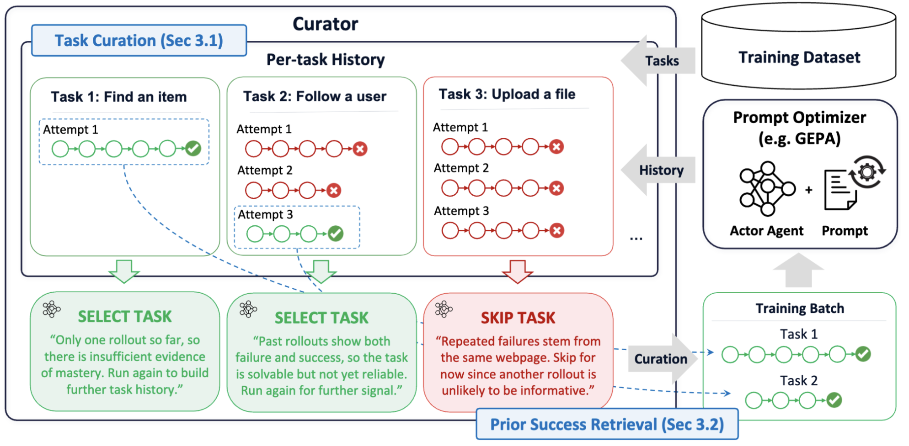
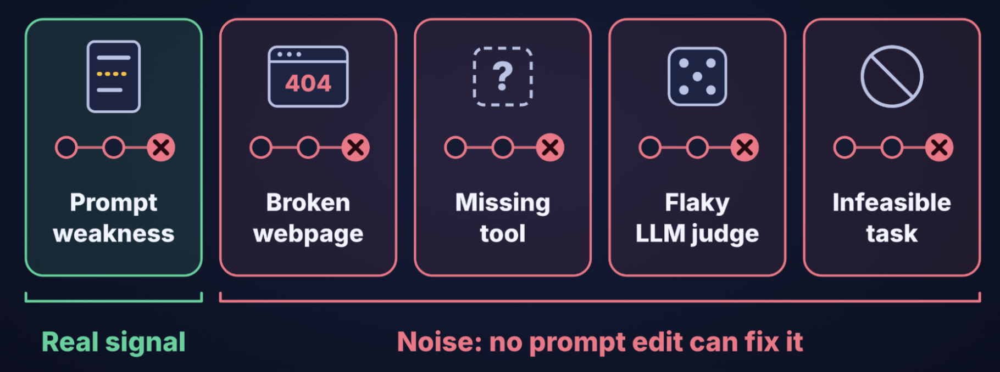
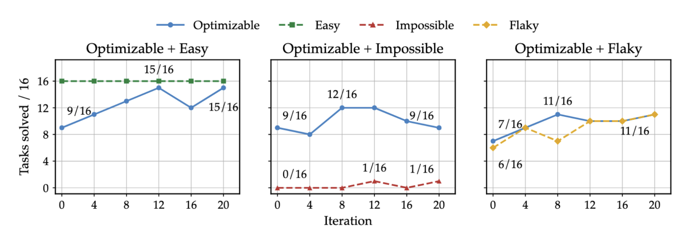
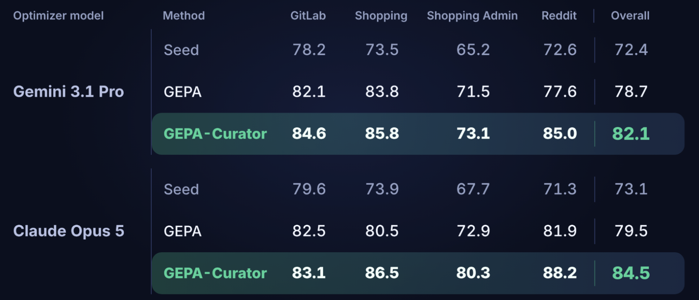
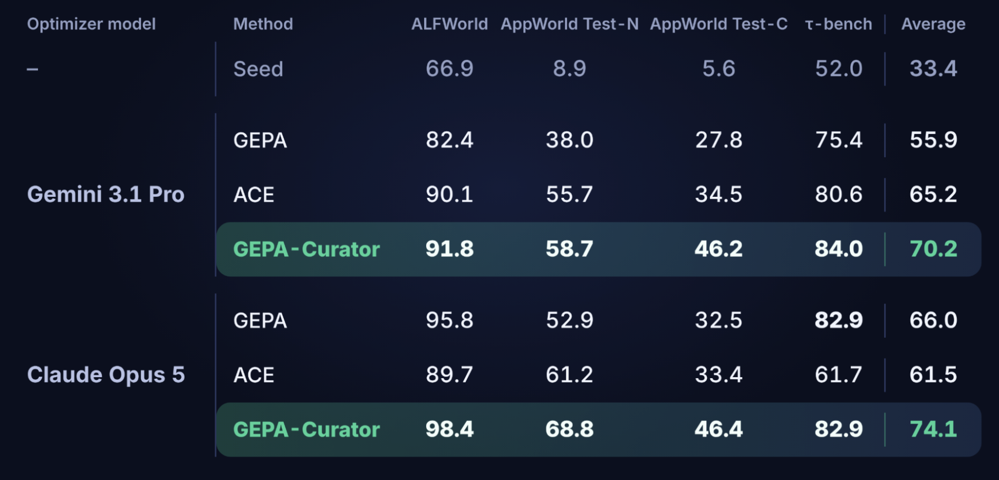

---
date:
  created: 2026-11-04
slug: gepa-curator
title: "GEPA-Curator: Curated Learning For Self Improving Agents"
description: GEPA-Curator is an agentic Curator that sits on top of reflective prompt optimizers and decides which agent experiences should shape the prompt, filtering out noisy tasks and retrieving trusted past successes for the Reflector.
citation_authors:
  - "Zack Yu"
  - "Nicholas Lee"
  - "Minjae Lee"
  - "Lakshya A Agrawal"
  - "Luca Manolache"
  - "Wonjun Kang"
  - "Matei Zaharia"
  - "Michael W. Mahoney"
  - "Kurt Keutzer"
  - "Sehoon Kim"
  - "Amir Gholami"
---

# GEPA-Curator: Curated Learning For Self Improving Agents

[Zack Yu](https://zack041.github.io/)\*, [Nicholas Lee](https://nicholaslee.me/)\*, [Minjae Lee](https://www.linkedin.com/in/mjleeofficial/), [Lakshya A Agrawal](https://x.com/LakshyAAAgrawal), [Luca Manolache](https://www.linkedin.com/in/luca-manolache-53569b220), [Wonjun Kang](https://www.linkedin.com/in/wonjun-kang-43b181342/), [Matei Zaharia](https://people.eecs.berkeley.edu/~matei/), [Michael W. Mahoney](https://www.stat.berkeley.edu/~mmahoney/), [Kurt Keutzer](https://people.eecs.berkeley.edu/~keutzer/), [Sehoon Kim](https://sehoonkim.org/)\*\*, [Amir Gholami](https://amirgholami.org/#about)\*\*

\* Equal Contribution   \*\* Equal Advising

**TL;DR.** Reflective prompt optimizers like GEPA improve agents by reading failed rollouts and revising the prompt. But in agentic settings, a failure is not always the prompt's fault: the harness may be missing a tool, the website may be broken, the task may be underspecified, or the LLM judge may simply be flaky. When the Reflector treats these failures as lessons, it writes rules that fix nothing and can break tasks that used to work.

We introduce **GEPA-Curator**, an agentic Curator that runs as a harness on top of an existing prompt optimizer and decides *which experiences should shape the prompt*. It does two things: **task curation** (skip tasks whose rollouts are unlikely to carry useful signal) and **prior success retrieval** (hand the Reflector a trusted past success of the same task, so it can compare instead of guess). Without changing the optimizer itself, GEPA-Curator:

- [Beats GEPA on every WebArena website we tested, with both Gemini 3.1 Pro and Claude Opus 5 as optimizer](#webarena), achieving up to **1.78×** GEPA's optimization gain over the seed prompt.
- [Matches or exceeds GEPA and ACE on ALFWorld, AppWorld, and τ-bench](#agentic-benchmarks), with gains of up to **20.7 points over GEPA** and **21.2 points over ACE**.
- [Costs only 1.31× GEPA in its efficient form, and is 4.42× cheaper than ACE](#cost) while reaching higher accuracy.
- [Carries over to harness-code optimization](#meta-harness): adding the Curator to Meta-Harness improves held-out performance as well.

<!-- more -->

<figure markdown="span">
  { style="width: 100%;" }
  <figcaption>The Curator runs “Find an item” again because one success gives little evidence of mastery. It also selects “Follow a user,” where a past success can help diagnose a later failure. It defers “Upload a file” after repeated failures on the same webpage.</figcaption>
</figure>

## When Failure Isn't the Prompt's Fault

Reflective prompt optimization is one of the most practical forms of self-improvement we have today: an agent acts in an environment, a Reflector reads the resulting trajectory, and the prompt gets revised for the next round. The whole loop rests on one assumption: **experience from past tasks contains signal that generalizes to future tasks.**

A zero score tells the Reflector that the rollout failed. It still has to decide what, if anything, a change to the prompt would fix.

<figure markdown="span">
  { style="width: 100%;" }
  <figcaption>These five rollouts can all end with the same score. A prompt edit can address an agent mistake. A broken webpage or an unreliable judge calls for a different diagnosis.</figcaption>
</figure>

Consider an agent buying an item on a shopping site. If it fails because it skipped a required option before adding to cart, the Reflector can usefully add "check required fields before proceeding." If it fails because the purchase button was temporarily broken, the "lesson" the Reflector learns ("look for alternative ways to complete the purchase") is noise at best, and actively harmful once the button works again.

### Isn't validation gating enough?

GEPA already guards against bad mutations: it re-evaluates a mutated prompt on the minibatch and only accepts it if the score doesn't drop, and other optimizers use held-out validation sets for the same purpose. But gating has two blind spots:

1. **Aggregate scores are noisy.** Stochastic execution and flaky judges mean bad mutations can slip through and good ones can be rejected.
2. **Gating acts after the fact.** It can veto a bad mutation, but it can't make the reflection itself any better.

That second point is the key motivation for GEPA-Curator: rather than only filtering what comes *out* of the Reflector, we curate what goes *in*.

### Noisy tasks contaminate the prompt

To see how much this matters, we split GoBrowse GitLab tasks into four groups: **Easy** (already solved by the seed prompt), **Optimizable** (initially weak but improvable by prompting), **Impossible** (always fail), and **Flaky** (mixed outcomes due to ambiguous intent or judge noise). We then run GEPA on Optimizable tasks mixed with each of the other three.

<figure markdown="span">
  { style="width: 100%;" }
  <figcaption>GitLab validation over 20 iterations. The blue line in each panel tracks the Optimizable tasks. The dashed line tracks the group mixed into training.</figcaption>
</figure>

With Easy tasks in the mix, GEPA solves 15 of the 16 Optimizable tasks by iteration 12 and reaches 15 again at iteration 20. With Impossible tasks, it peaks at 12 and finishes at 9. With Flaky tasks, its best checkpoint solves 11. The training mix changes how much GEPA learns even on the tasks that a prompt edit can improve.

### Anatomy of a bad lesson

Here's what contamination looks like up close. In one run, two Impossible tasks failed under the parent prompt; both had underspecified intents that named neither a target repository nor a group, so the actor wandered until it ran out of steps. The judge's feedback suggested browsing more broadly, and the Reflector dutifully turned that into a new rule:

> **Exhaustive Exploration:** Global code search is often limited or disabled. If a search yields no results, manually navigate through groups, projects, and repository file trees. Always check "Your groups", "Your projects", and your personal dashboard before defaulting to public "Explore" tabs, as task resources are usually associated with your account.

The rule did nothing for the Impossible tasks. But it broke a solvable one. On "Check the guide to WCAG documents and standards," the actor had previously opened the A11Y Project from its start page, used *Find file*, and reached the guide in five actions. Under the new prompt, it instead detoured through personal projects, Explore, Topics, Help, global search, and group pages, returned to the A11Y Project, inspected the README and Wiki, and burned all 30 actions in the `src` directory without ever reaching the guide.

And yet the minibatch score went *up*, from 8 to 9, so the mutation was accepted.

<!-- figure of [new, optional]: side-by-side action traces for the WCAG task before vs. after the "Exhaustive Exploration" mutation — 5 actions to success vs. 30 actions to failure — with the minibatch score 8 → 9 annotated. -->

This isn't a rare edge case. The Curator ended up flagging about 4.7% of GoBrowse training tasks as impossible or flaky at some point. Under uniform sampling with a minibatch of 16, that means **roughly 54% of minibatches contain at least one such task**, and since reflection is driven by failures and these tasks fail far more often than the rest, they get outsized influence on what the Reflector writes.

## GEPA-Curator

GEPA-Curator treats the prompt optimizer as a black box with a simple interface: it takes a prompt, a minibatch of tasks, and optional metadata, and returns an updated prompt along with trajectories and evaluations. The Curator sits outside that loop, maintains a **per-task history** of trajectories and outcomes, and uses it in two ways. Everything it produces is passed in as extra input metadata; the optimizer itself is unchanged.

### Task Curation: choosing what to learn from

Instead of shuffling through the dataset, the Curator decides for each task whether another rollout is worth running right now. Unseen and underexplored tasks are run first to build up history. As evidence accumulates, the Curator may skip a task when the history strongly suggests another rollout won't help, for instance:

- **Mastered:** multiple stable, clean successes across separate rollouts, with no recent regression.
- **Operationally impossible:** repeated, independent attempts point to the same missing capability in the tools or UI.
- **Flaky or uninformative:** materially similar behavior keeps receiving inconsistent outcomes, with no link to prompt changes.
- **Infrastructure failure:** the evaluator explicitly reports a recovered execution crash. An actor that runs out of time and receives a failing score has an ordinary failed rollout.

The default under uncertainty is to **run**, not skip: a rollout has information value for testing suspected flakiness or a possible regression.

**Skipping is temporary.** The full Curator in the paper reconsiders skipped tasks each epoch. In the current efficient implementation, the Curator chooses a cooldown when it skips a task. For example, a two-epoch skip at epoch 3 schedules a rollout at epoch 5. The scheduler runs it then without another Curator call, giving the updated prompt a chance to show progress or reveal a regression.

### Prior Success Retrieval: compare, don't guess

A standard Reflector sees only the failed trajectory and its evaluation, and has to diagnose the failure from that alone. GEPA-Curator gives it something better: a **trusted past success on the same task**. With a failed and a successful trajectory side by side, the Reflector can perform a kind of contrastive diagnosis: *what did the agent do differently when it worked?*

In the current implementation, the Curator keeps one reference success per task in each prompt lineage. It can select a single convincing rollout as that reference. The Curator looks for repeated clean successes across separate rollouts before calling a task *mastered*.

When a task comes up for a decision, the same Curator call handles scheduling and, if the latest execution contains an eligible success, reference selection. Suppose the agent failed before a mutation and succeeded afterward. This response schedules another rollout and keeps the successful after-mutation trajectory for future reflection.

```json
{
  "task_status": "prompt_sensitive",
  "decision": "run",
  "skip_epochs": 0,
  "skip_type": null,
  "selected_success": "after"
}
```

For a skip, the Curator sets a positive `skip_epochs` and uses `skip_type` of `mastered` or `low_signal`. It includes `selected_success` only when an eligible success is offered. It can choose an offered `before` or `after` rollout, or choose `retained` to keep the existing reference, even when the reference is empty.

<!-- TODO: if GEPA-Curator ships in the gepa package, add a short usage snippet here in the style of the optimize_anything post (e.g., how to enable the Curator on top of an existing GEPA run). -->

## Results

We use gpt-oss-120b as the actor and evaluate two optimizer models, Gemini 3.1 Pro and Claude Opus 5, which drive all optimizer-side agents (Reflector and Curator) in a run. GEPA-Curator builds on a simplified, greedy variant of GEPA that keeps a single lineage instead of a Pareto pool; in our ablation, removing Pareto selection made little difference for GEPA (82.8 vs. 82.5). All numbers are held-out test success rates averaged over 5 runs.

### WebArena (GoBrowse) {#webarena}

We evaluate on four GoBrowse websites in WebArena (GitLab, Shopping, Shopping Admin, and Reddit), each split 3:1:1 into train, validation, and test, with 5,000 rollouts per website/method.

<figure markdown="span">
  { style="width: 100%;" }
  <figcaption>GoBrowse held-out success rates (%). The largest site-level gain over GEPA is on Reddit with Gemini (77.6 to 85.0) and on Shopping Admin with Claude (72.9 to 80.3).</figcaption>
</figure>

GEPA-Curator improves over GEPA on all four websites with both optimizers. Measured as gain over the seed prompt, GEPA-Curator achieves **1.54×** GEPA's improvement with Gemini 3.1 Pro (+9.7 vs. +6.3) and **1.78×** with Claude Opus 5 (+11.4 vs. +6.4).

**Key result:** Curation consistently increases how much a prompt optimizer can extract from the same seed prompt and the same rollout budget, across websites and optimizer models.

### ALFWorld, AppWorld, and τ-bench {#agentic-benchmarks}

To check that curation isn't only useful on noisy web tasks, we also evaluate on ALFWorld, AppWorld (Test-Normal and Test-Challenge), and τ-bench (retail, with user interaction flattened into single requests), and add ACE as a second baseline.

<figure markdown="span">
  { style="width: 100%;" }
  <figcaption>Held-out success rates (%). The average gives equal weight to the four test settings, counting AppWorld Test-N and Test-C separately.</figcaption>
</figure>

With Gemini 3.1 Pro, GEPA-Curator beats both baselines on all four test sets, averaging +14.3 points over GEPA and +5.0 over ACE. With Claude Opus 5, it gains +15.9 on AppWorld Test-N and +13.9 on Test-C over GEPA, and ties GEPA on τ-bench, averaging +8.1 over GEPA and +12.6 over ACE.

**Key result:** Task curation and prior success retrieval are general tools, not a patch for one noisy benchmark. Gains reach 20.7 points over GEPA and 21.2 points over ACE.

## Why Does Curation Work?

### Both components matter, and they're complementary

We ablate each component on the GitLab subset (520 train / 200 eval tasks), keeping the seed prompt, models, and budget fixed.

| Method | Success (%) |
|---|---|
| Seed | 78.2 |
| GEPA | 82.8 |
| GEPA w/o Pareto selection | 82.5 |
| Task curation only | 84.2 |
| Prior success retrieval only | 84.7 |
| **GEPA-Curator (full)** | **88.6** |

Each component alone beats GEPA by under 2 points; together they add nearly 6. This fits the intuition: **task curation decides which failures the Reflector sees, and success retrieval improves how it reasons about them.**

### Success/failure counts alone aren't enough

Could a simple rule-based curriculum do the same job? We compare against a numerical curriculum that tracks each task's failure streak and drops tasks that fail too often, on a mixed dataset of 48 Easy, 54 Optimizable, 45 Impossible, and 21 Flaky tasks.

| Method | Success (%) |
|---|---|
| GEPA | 66.2 |
| Numerical curriculum | 62.5 |
| Task curation only | 67.4 |
| **GEPA-Curator** | **70.2** |

The numerical curriculum actually *underperforms* GEPA. The reason is that Flaky and prompt-sensitive tasks look the same in a win/loss record: both show mixed success and failure. Telling them apart requires reading the trajectories, which is exactly what an agentic Curator can do.

### What does the Curator actually skip?

Across the four GoBrowse runs, the Curator flagged 75 of 1,581 training tasks (4.7%) as impossible or flaky at least once.

<!-- figure of: three donut charts — all training tasks (Good / Impossible / Flaky), causes of impossible diagnoses, causes of flaky diagnoses — Figure 3 in the paper. -->

**Most "impossible" diagnoses trace back to the harness or environment** (12 of 18), such as a required tool being unavailable. For flaky diagnoses, **faulty or underspecified task descriptions are the leading cause** (30 of 65), followed by harness/environment limitations, which can lead a lenient judge to accept an actor's claim that a task can't be done.

The Curator also adjusts *how often* it revisits tasks rather than retiring them. Impossible tasks are deferred the longest, with mean skip streaks growing from 5.5 to 8.75 epochs over training; mastered tasks are deferred longer over time but periodically rechecked for regressions; flaky tasks are revisited more often to resolve uncertainty.

<!-- figure of [new, optional]: mean skip-streak length before rerun by phase (early / middle / late) for Mastered, Impossible, and Flaky tasks — from Table 12 in the appendix. -->

### How often does the Reflector get a reference success?

As optimization proceeds, successes accumulate and retrieval kicks in more often: the share of failed reflections paired with a trusted success rises from **6.9% early to about 50%** in the middle and late phases. The Curator is also selective: for 11.6% of eligible tasks, it made a non-trivial judgment about the success pool, either picking a reliable success over a noisy one or explicitly abstaining because every available "success" looked contaminated or evaluator-lenient.

## Beyond Prompts: Curating Harness Optimization {#meta-harness}

Curation isn't tied to prompts. [Meta-Harness](https://openreview.net/forum?id=tmbOUyFx3R) optimizes an agent's harness *code* with a coding agent, much as GEPA optimizes prompts. We add a Curator that selects a parent harness and a focused subset of training tasks with a rationale, and supplies historical successes when fresh parent runs fail. We call this **Meta-Harness-Curator**.

| Setting | Metric | Meta-Harness | MH-Curator |
|---|---|---|---|
| Math-RAG | Overall accuracy | 45.33 | **46.33** |
| Math-RAG | Overall reward | 45.69 | **47.26** |
| Text classification | Overall accuracy | 48.06 | **51.04** |

**Test scores (%), averaged over three samples per task.**

The gains are modest but consistent at the aggregate level. On text classification they are concentrated in LawBench (+5.8) and Symptom2Disease (+3.6), with USPTO slightly lower. Even when the optimizer is an autonomous coding agent that can inspect the full history itself, a Curator that points it at the right tasks and the right evidence still helps.

## What Does It Cost? {#cost}

The full Curator reads a lot of history. For practical use we built an **efficient variant** with three changes: the Curator decides *how many* epochs to skip a task instead of re-deciding every epoch; older executions are kept as compact summaries rather than full trajectories; and a single best successful trajectory is retained per task as the reference.

The efficient variant matches the full method on held-out performance (and is even higher on AppWorld). Its cost, including rollouts, reflection, and curation, compares as follows:

<!-- figure of [new, optional]: cost vs. accuracy scatter — GEPA, ACE, and Efficient GEPA-Curator on WebArena and non-WebArena benchmarks, from Table 8. -->

| Benchmarks | Method | Total cost (USD) | Avg. accuracy (%) |
|---|---|---|---|
| WebArena (4 sites) | GEPA | 594.05 | 78.7 |
| | **Efficient GEPA-Curator** | 776.88 | **82.3** |
| ALFWorld + AppWorld + τ-bench | GEPA | 132.65 | 55.9 |
| | ACE | 768.69 | 65.2 |
| | **Efficient GEPA-Curator** | 173.98 | **74.4** |

**Key result:** For a **1.31×** increase in optimization cost, Efficient GEPA-Curator gains +3.6 points over GEPA on WebArena and +18.5 points on the other agentic benchmarks. It is **4.42× cheaper than ACE** while scoring 9.2 points higher. Our actor (gpt-oss-120b) is cheap, so curation overhead is a relatively large share of the bill here; with a more expensive actor, the cost ratio to GEPA would shrink considerably.


[Paper on arXiv](https://arxiv.org/abs/2610.37651v1) · [GEPA-Curator implementation](https://github.com/zack041/gepa-public/tree/gepa-curator)
